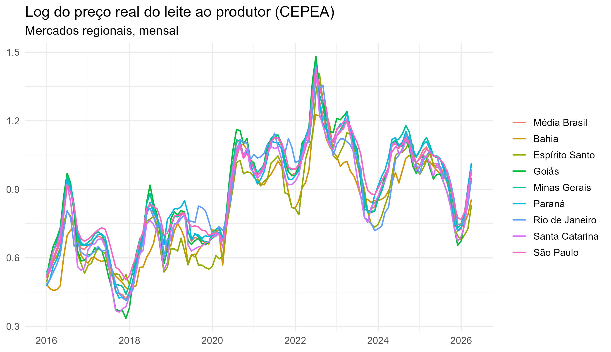
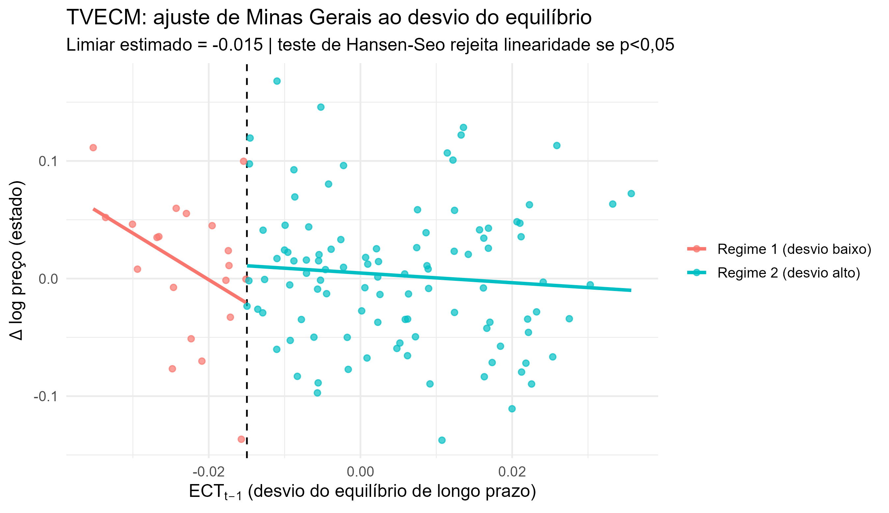

# Transmissão de Preços do Leite ao Produtor entre Regiões Brasileiras

Análise econométrica da **integração e transmissão espacial** de preços do leite ao
produtor entre as principais regiões do Brasil, com dados mensais do **CEPEA/ESALQ-USP**
(jan/2016–abr/2026) deflacionados pelo **IPCA**. O estudo aplica o arcabouço clássico de
transmissão de preços agrícolas — cointegração, correção de erro, assimetria e modelos
com limiar (TVECM).

 

## Resultados

Os resultados numéricos estão nas tabelas (`resultados_transmissao/tab_*.csv`) e nas figuras
(`resultados_transmissao/fig/`), todos gerados pelos scripts em `R/`.

<p align="center">
  
  
</p>

## Estrutura do repositório

```
.
├── R/                              # scripts (rodar a partir da raiz do repositório)
│   ├── construir_base_cepea.R      #  1. lê os .xls do CEPEA -> dados/cepea_leite_regioes.csv
│   ├── analise_transmissao_leite.R #  2. análise de transmissão (figuras + tabelas + relatório)
│   ├── gerar_latex.R               #  3. gera as tabelas .tex (pasta local, não versionada)
│   └── analise_preco_leite.R       #  (complementar) previsão univariada via API do IPEA
├── dados/
│   ├── brutos_cepea/               # 12 planilhas .xls originais do CEPEA (fonte)
│   └── cepea_leite_regioes.csv     # base tratada (long): região × mês × preços
├── resultados_transmissao/
│   ├── fig/                        # 7 figuras (PNG 300 dpi)
│   ├── tab_*.csv                   # tabelas de resultados
│   └── relatorio_transmissao.txt   # saída textual dos testes
├── LICENSE  ·  .gitignore  ·  README.md
```

O texto do artigo, PDFs, DOCX e pacotes `.zip` não são versionados (`.gitignore`); o PDF
da versão final do artigo será publicado aqui quando estiver disponível.

## Como reproduzir

**Requisitos:** R ≥ 4.2 · [LibreOffice](https://www.libreoffice.org/) (converter os `.xls`
do CEPEA).

Pacotes R: `tidyverse, lubridate, zoo, urca, vars, tseries, forecast, lmtest, sandwich,
tsDyn, reshape2, plotly, htmlwidgets, httr, jsonlite, kableExtra, readxl` (os scripts
instalam o que faltar).

Rode **a partir da raiz do repositório**:

```r
source("R/construir_base_cepea.R")      # (opcional) regenera o CSV a partir dos .xls
source("R/analise_transmissao_leite.R") # gera figuras, tabelas e relatório
source("R/gerar_latex.R")               # gera as tabelas .tex e atualiza overleaf/
```

## Dados

- **Preço do leite**: Indicador CEPEA/ESALQ-USP — preço líquido médio recebido pelo
  produtor (R$/litro), mensal, por região. Fonte: <https://www.cepea.esalq.usp.br/br/indicador/leite.aspx>
- **Deflator (IPCA)**: número-índice do IBGE (série `PRECOS12_IPCA12` da API OData do IPEA),
  versionado em `dados/ipca_indice.csv` (`date`, `indice`, base abr/2026 = 1). O script lê esse
  arquivo primeiro e só recorre à API se ele não existir; sem IPCA a análise para, em vez de
  cair em preços nominais. O arquivo foi reconstruído a partir do painel deflacionado da
  rodada de 30/06/2026 (`painel_precos.csv` ÷ preços nominais, idêntico nas 9 regiões até
  1e-16); ao baixar o IPCA oficial de novo, basta sobrescrevê-lo.
- Mantêm-se as 9 regiões com cobertura completa (Média Brasil + BA, ES, GO, MG, PR, RJ,
  SC, SP); Ceará e Mato Grosso do Sul foram excluídos por séries interrompidas.

## Metodologia

Raiz unitária (ADF, PP, KPSS) · cointegração de **Johansen** e **Phillips-Ouliaris** ·
**ECM** e **ECM assimétrico** (von Cramon-Taubadel & Loy) · cointegração com limiar
**M-TAR** (Enders & Siklos) · **TVECM** com teste de **Hansen & Seo** (banda de
não-arbitragem; Balke & Fomby) · **causalidade de Granger** · **VAR/IRF/FEVD**.

Escolhas de especificação (revisão de out/2026):

- Raiz unitária: além do ADF com tendência, ADF só com intercepto e **Zivot-Andrews**
  (quebra endógena em nível e tendência), para arbitrar entre ADF e KPSS.
- Johansen par a par: defasagem escolhida **no próprio par** (critério de Schwarz), não o
  K do sistema de 9 séries; a estatística do traço é reportada na Tabela 3. Pares sem
  cointegração por nenhum teste têm o ECM marcado como descritivo.
- M-TAR: além de τ = 0, limiar estimado por **Chan (1993)**, com p-valor de simetria por
  bootstrap de regressores fixos (999 réplicas), porque o F não é padrão com τ estimado.
- Hansen-Seo: **1.000** réplicas (antes 100) e semente fixada por par; coeficientes de
  ajuste com |α| > 1 são sinalizados como sobreajuste.

## Licença e citação

Code: MIT ([LICENSE](LICENSE)). Text, documentation and data: see [LICENSING.md](LICENSING.md).

Código sob licença **MIT** (ver [LICENSE](LICENSE)). Os dados pertencem ao CEPEA/ESALQ-USP
e ao IBGE/IPEA (redistribuídos apenas para reprodutibilidade acadêmica).

> Bezerra, V. (2026). *Transmissão de preços do leite ao produtor entre regiões
> brasileiras: cointegração, correção de erro, assimetria e modelos com limiar (TVECM)*.

**Autor:** Valber Bezerra — valber.gregory@gmail.com
